<p align="center">
  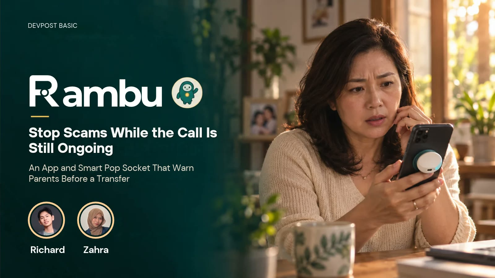
</p>

<p align="center">
  <b>Rambu warns older parents about scam calls while the call is still going, and lets their family step in before money or a code changes hands.</b>
</p>

<p align="center">
  
  
  
  
  
  
</p>

---

## See it work

<table>
<tr>
<td width="42%" align="center">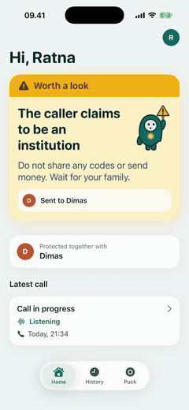</td>
<td>

A fake bank officer calls Ratna. Her phone is on loudspeaker and Rambu is listening.

1. **"I'm calling from your bank"** turns the card amber: *Worth a look*. Her son Dimas gets the caller's exact words on his phone.
2. **"Read me the six digit code"** turns it red: *Danger*.
3. Dimas taps **Scam**. Ratna's phone switches to a flashing red **HANG UP NOW** screen with an alarm, vibration and a spoken warning. It keeps going until she taps *I hung up*.

The first warning arrives about 14 seconds into the call.

</td>
</tr>
</table>

## Why

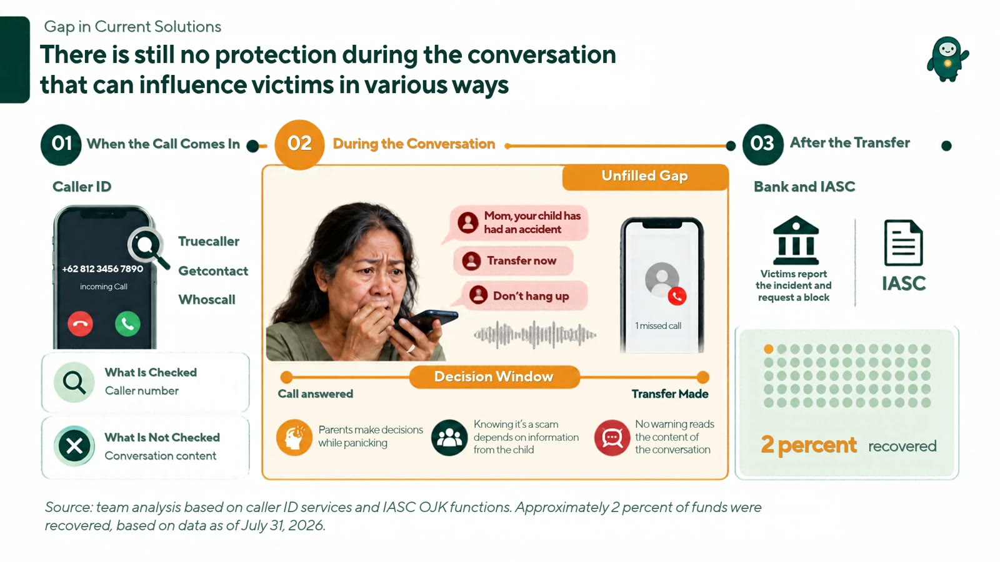

Caller ID and spam lists only judge the number. A scammer on a fresh number who claims to be the bank sounds convincing to a parent alone at home, and the family usually hears about it after the transfer. Rambu listens to *what is said* during the call and brings in the people the parent already trusts.

## How it works

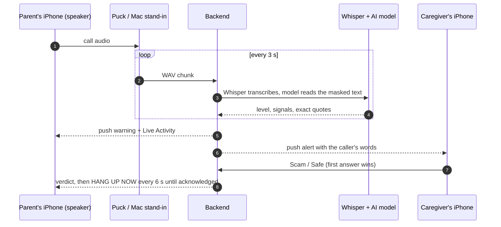

| | |
|---|---|
| **Risk levels** | `low` · `needs_review` (worth a look) · `high_risk` (danger) |
| **Scam signals** | impersonation · urgency · secret code · transfer · remote-access app |
| **Evidence** | Every warning quotes the caller word for word. The backend drops any quote the model can't match in the transcript, and a keyword check catches plain requests for a code if the model misses them. |
| **Privacy** | Codes, PINs and account numbers are masked before anything is stored or sent to the model. Audio stays in memory. Caregivers see only the flagged sentences. |
| **Failure** | A call that couldn't be analysed shows *Could not assess*, never *Safe*. |

## Screens

<table>
<tr>
<td align="center" width="20%">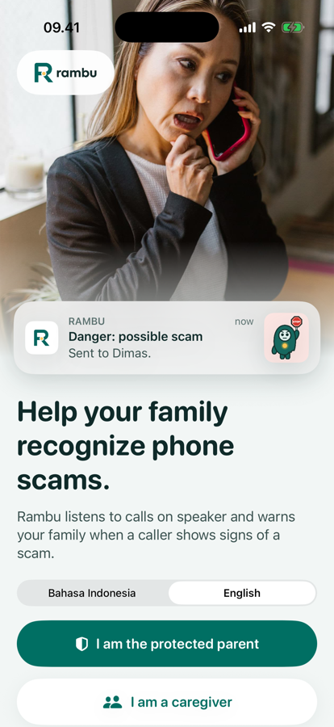<br><sub>Pick a role, English or Bahasa Indonesia</sub></td>
<td align="center" width="20%">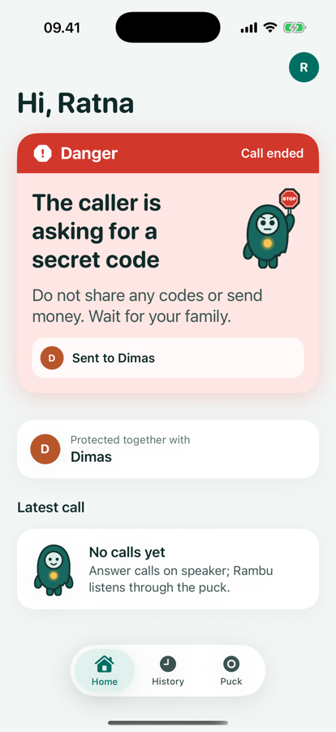<br><sub>Parent: live warning</sub></td>
<td align="center" width="20%">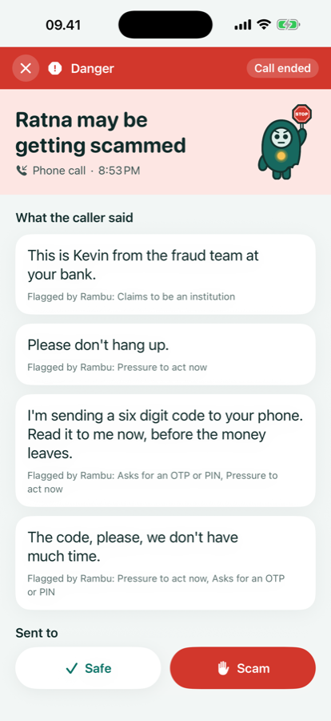<br><sub>Caregiver: what the caller said, Scam or Safe</sub></td>
<td align="center" width="20%">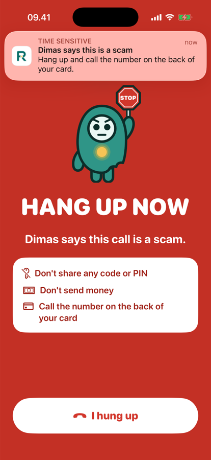<br><sub>Parent: after the family says Scam</sub></td>
<td align="center" width="20%">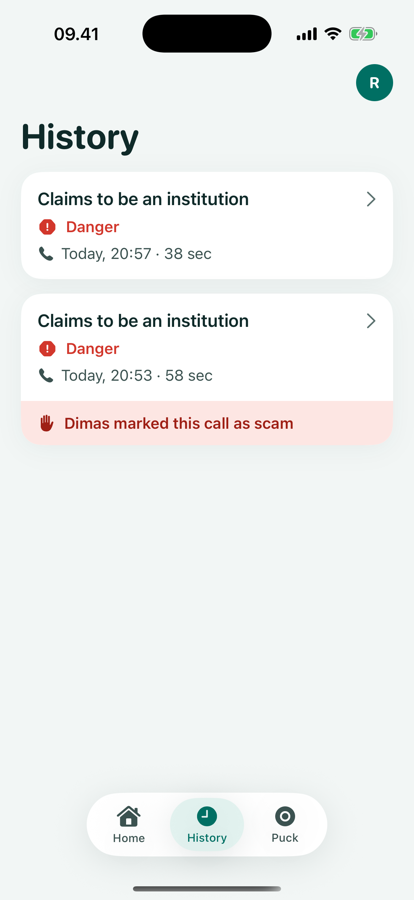<br><sub>History with the family's verdict</sub></td>
</tr>
</table>

## Who it's for

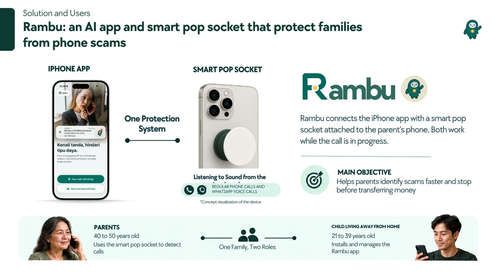

Older parents in Indonesia who get calls from people posing as a bank, the police or a relative in trouble, and grown children who live in another city and can't be there when the phone rings.

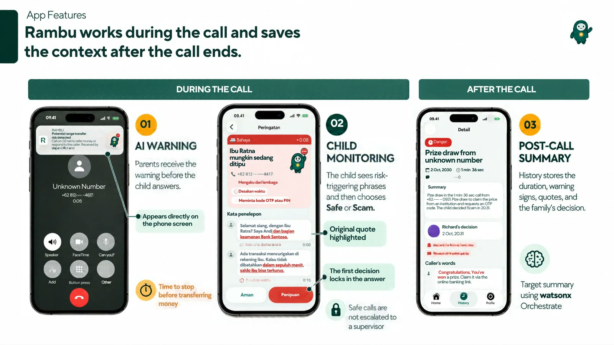

> **In this build:** phone calls on loudspeaker, live warnings with quotes, caregiver Scam/Safe, the hang-up alarm, history, English and Bahasa Indonesia.
> **Planned, not built yet:** WhatsApp voice calls (slide 3) and the AI call summary (slide 4).

## Run it

You need a Mac with Xcode 27, `brew install uv ffmpeg xcodegen cloudflared`, an [OpenRouter](https://openrouter.ai) API key, and an Apple Developer account for push notifications.

**1. Backend**

```bash
cd backend
cp .env.example .env    # add OPENROUTER_API_KEY and the APNS_* values
uv run uvicorn rambu.main:create_app --factory --port 8001 --env-file .env
```

The first start downloads the Whisper `small` model (about 500 MB). Data lives in `backend/data/rambu.sqlite3`.

**2. iPhone app**

```bash
cd ios && xcodegen generate && open Rambu.xcodeproj
```

Pick your team under Signing & Capabilities and run on two devices or two simulators. One sets up as the parent, the other joins as a caregiver with the six-digit code from the parent's phone.

Real phones need a public address for the backend: run `cloudflared tunnel --url http://localhost:8001` and enter the printed URL under **Profile → Server address**. Simulators can use `http://127.0.0.1:8001` directly.

**3. Listen to a call**

The Mac's microphone stands in for the puck in this version. Pair it with the invite code from the parent's phone (Profile → Invite a caregiver):

```bash
uv run --project backend python tools/mac_puck.py --server http://127.0.0.1:8001 --code 123456
```

It starts when someone speaks and ends the call after six seconds of quiet. Mute the simulators' *Read alerts aloud* so the Mac doesn't hear its own warnings.

No microphone? Play a recorded test call through the same pipeline (set `DEV_PUCK_TOKEN` in `backend/.env` first):

```bash
cd backend && DEV_PUCK_TOKEN=… uv run python scripts/fake_puck.py ../samples/test-calls/bank-otp-en.wav
```

**Tests**

```bash
cd backend && uv run pytest                      # 23 tests
cd ios && xcodebuild -project Rambu.xcodeproj -scheme Rambu \
  -destination 'platform=iOS Simulator,name=iPhone 17 Pro' test   # 12 tests
```

`tools/record_demo.sh ~/Movies/take1` records both simulators side by side for a demo video.

## Repository

| Path | What's there |
|---|---|
| [`backend/`](backend/) | Python 3.12 + FastAPI: call pipeline, scam analysis, families, alerts, Apple push |
| [`ios/`](ios/) | SwiftUI app with a Live Activity widget (XcodeGen project) |
| [`firmware/rambu-puck/`](firmware/rambu-puck/) | ESP32 firmware for the puck |
| [`tools/`](tools/) | Mac stand-in puck and the demo recording script |
| [`samples/test-calls/`](samples/test-calls/) | Synthetic scam and safe calls (macOS text-to-speech) |
| [`devpost/`](devpost/) | Scope, PRD, technical spec, build checklist and an [app map](devpost/app-map.html) |

## The puck

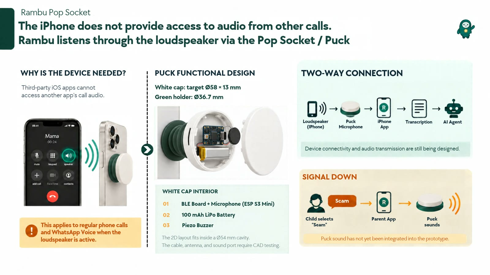

The puck is an ESP32 with an I²S microphone in a 3D-printed case on the back of the phone. It uses the iPhone's notification service (ANCS) to know when a call is answered, records at 16 kHz and uploads 3-second pieces over Wi-Fi. The firmware is in this repo and compiles. Recording on the puck itself and pairing it from the app are the next hardware phase, so the demo uses the Mac stand-in, which talks to the backend through the same API. The battery and buzzer version on the slide is the concept for later.

<details>
<summary><b>Parts, wiring and firmware</b></summary>

### Parts

| Part | Qty | Notes |
|---|---|---|
| ESP32 DevKit V1, 30-pin, USB-C | 1 | headers soldered |
| INMP441 I²S microphone, round board | 1 | headers soldered |
| Female–female jumper wires, 10 cm | 6 | |
| USB-C cable | 1 | plug housing no larger than 12 × 7 mm |
| Thick foam double-sided tape (2–3 mm) | some | mic ring and board gap |
| 3D-printed case: body + lid | 1 set | PETG (or PLA+), white |

Case: Ø66 × 30 mm, lid snaps on at three points with a 7-hole grill over the mic. Print at 0.2 mm layers, 3 walls, 20% infill, no supports.

### Wiring

| Mic pin | ESP32 pin | GPIO |
|---|---|---|
| VDD | 3V3 | |
| GND | GND | |
| L/R | GND | (left channel) |
| SD | D32 | GPIO32 |
| SCK | D33 | GPIO33 |
| WS | D25 | GPIO25 |

### Firmware

```bash
arduino-cli core install esp32:esp32
arduino-cli lib install ArduinoJson NimBLE-Arduino
arduino-cli compile --fqbn esp32:esp32:esp32:PartitionScheme=huge_app firmware/rambu-puck
arduino-cli upload  --fqbn esp32:esp32:esp32:PartitionScheme=huge_app -p /dev/cu.usbserial-XXXX firmware/rambu-puck
```

- Advertises as "Rambu Puck" over Bluetooth and subscribes to ANCS. An answered call starts recording; when it ends, recording stops.
- Records at 16 kHz and sends 3-second WAV pieces at 8 kHz over HTTPS to `/api/puck/sessions/...`. A loudspeaker call carries about 300–3400 Hz, and 8 kHz keeps two buffers within the ESP32's RAM next to Wi-Fi, TLS and Bluetooth.
- Blue LED on while recording, slow blink while Wi-Fi is down, heartbeat every minute.
- Settings come from the app over Bluetooth, or from the serial console at 115200 baud:

```
config {"ssid":"…","pass":"…","url":"https://….trycloudflare.com","token":"…"}
status
start
stop
```

Bluetooth service `6b1f0001-5a3e-4c8e-9d2a-7a0c52b1e001`: `…0002` info (read), `…0003` settings JSON (encrypted write), `…0004` status (notify), `…0005` start/stop (encrypted write).

**Next hardware phase:** smaller PopSocket-sized builds, such as an ESP32-S3 SuperMini on a cable (about Ø36 × 12 mm), a XIAO ESP32S3 with a 200 mAh LiPo (about Ø40 × 15 mm), or a custom PCB (about Ø40 × 9 mm).

</details>

## Built with

Planned and built for [Devpost Learn "Build With AI: Basics"](https://learn-ai-basics.devpost.com/) with its skill pack and Claude Code. The planning documents are in [`devpost/`](devpost/).

Made by Richard and Zahra. Released under the [MIT License](LICENSE).
